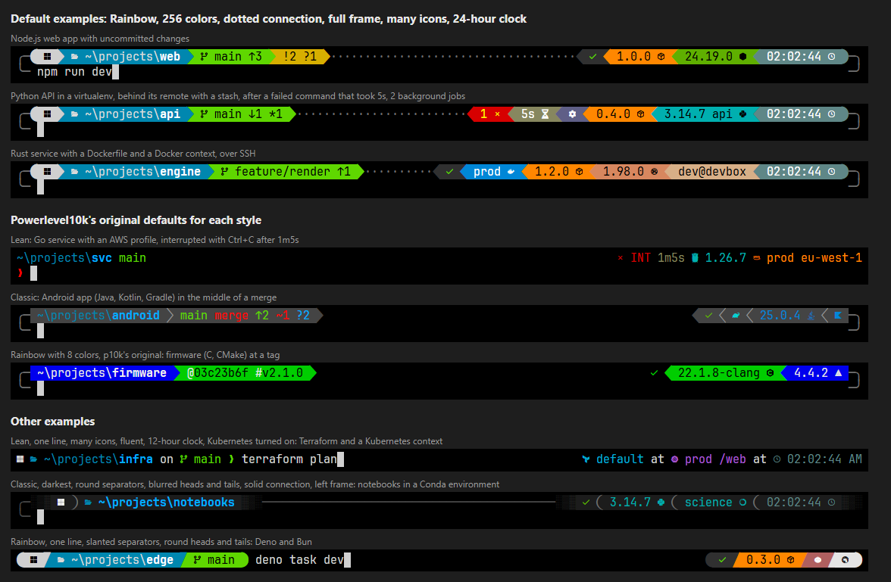
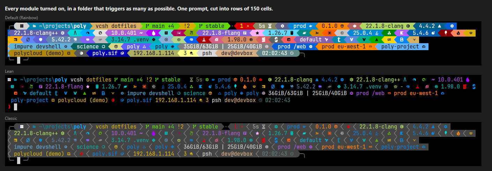

# starlevel10k — Powerlevel10k styles for Starship

Powerlevel10k’s look and configuration experience, rebuilt for [Starship](https://starship.rs/) across PowerShell, Zsh, Bash, Fish, Nushell, and Cmd with Clink.

Lean, Classic, and Rainbow styles, extended with Starship’s default module lineup. A single-page HTML configurator gives you a live preview and generates your `starship.toml` without a build step or server.

### [Open the interactive configurator](https://odt1.github.io/starlevel10k/configure.html)

Use the hosted page, or download [configure.html](configure.html) and open it in your browser. It works offline, with no external dependencies.



All preview images are real Starship output with Nerd Font icons.

## Why This Exists

Powerlevel10k gave Zsh users a great prompt configuration wizard, but it is specific to Zsh and now has [very limited support, with no new features planned](https://github.com/romkatv/powerlevel10k). Starship supports many shells, but wiring a full Powerlevel10k-style layout in `starship.toml` by hand takes work.

`starlevel10k` brings familiar p10k appearance choices to Starship’s cross-shell engine:

- **The familiar p10k choices:** Lean, Classic, and Rainbow styles, with controls for colors, separators, heads and tails, one or two lines, frames, connections, spacing, icons, concise or fluent prompt flow, and transient prompts. This is an adaptation of the wizard, not a reproduction of every question or feature.
- **Extended with Starship’s default module lineup:** Layout and styling for every module in Starship 1.26.0’s default prompt, including its optional, disabled-by-default modules. Language runtimes, build tools, containers, and cloud contexts go beyond the original p10k segment set. This does not include every module in Starship’s catalog.
- **Live browser preview:** Hover over an answer to preview it before selecting it. Try six Git states—changes, clean, merge conflict, rebase, detached at a tag, and no repository—and toggle a Python virtualenv, background jobs, a read-only directory, or root over SSH.
- **Reload your choices:** Wizard answers are saved in a `# p10k-starship:` comment. Load a generated file to change your layout while keeping recognized module on/off overrides. Other manual TOML edits are not preserved when the file is regenerated.
- **Shell setup included:** The page generates setup snippets for PowerShell, Zsh, Bash, Fish, Nushell, and Cmd with Clink, including shell-specific transient prompt setup. When PowerShell needs a right prompt, the page also provides the full `p10k-starship.ps1` add-on with Copy and Download buttons.

## Quick Start

1. Install [Starship](https://starship.rs/) and a [Nerd Font](https://www.nerdfonts.com/), then select that font in your terminal. Starship 1.26.0 is the tested baseline; use that version or newer.
2. Download [configure.html](configure.html) and open it in your browser.
3. Pick your options and click **Download starship.toml**.
4. Save the file to `~/.config/starship.toml`, or point `STARSHIP_CONFIG` at it. Back up an existing config before replacing it.
5. Copy the snippet from **Set up your shell** into your shell’s startup file. For PowerShell layouts that need it, save the add-on shown below the profile snippet and adjust its path.

Prefer p10k’s original starting answers? Copy one of the ready-made configs instead:

```sh
cp p10k-classic.toml ~/.config/starship.toml
```

The page’s starting layout is Rainbow with Lean-derived 256-color backgrounds, a dotted connection, a full frame, many Nerd Font icons, and a 24-hour clock. The ready-made files use p10k’s per-style starting answers instead; neither is a byte-for-byte port of native p10k.

### Files

| File | Purpose |
| --- | --- |
| `configure.html` | Offline configurator, generator, preview, and shell setup snippets. |
| `p10k-lean.toml`, `p10k-classic.toml`, `p10k-rainbow.toml` | Ready-made configs using p10k’s per-style starting answers. |
| `p10k-starship.ps1` | PowerShell right-prompt add-on, also embedded in the configurator. |
| `preview.png` | Default examples, original per-style starting answers, and other examples. |
| `preview-all.png` | Examples with all generated modules enabled. |

## Fonts and Icons

A Nerd Font is required for the separators and frame, even if you choose Starship’s default symbols.

- **Nerd Font Mono**, such as JetBrainsMono Nerd Font Mono, keeps icons within a single cell. Icons look smaller; start with Icon Padding set to **None**.
- **Nerd Font**, such as JetBrainsMono Nerd Font, can draw icons wider than their one-cell advance. The generated formats include spacing after icons, so **None** often works here too. Try **Moderate** if icons run into the following text.

**Icon Set** chooses between Starship’s `nerd-font-symbols` preset and Starship’s default symbols, which are mostly emoji with some text and Nerd Font glyphs. The latter is an optional alternative, not a font-free mode. Symbols without a Starship equivalent use substitutes, such as a folder, hourglass, clock, and success emoji.

One deliberate difference from Starship’s default symbols: U+FE0F variation selectors are stripped. Starship’s width calculation can count a character-plus-FE0F symbol as one cell while terminals display it as two, disrupting alignment. Emoji appearance and width still depend on your terminal and fonts.

## Changing Your Answers

Every generated file starts with your answers and a `# p10k-starship:` settings line. Open the page, click **Load settings from a file**, select your generated `starship.toml`, change your answers, and download it again.

**Regeneration replaces the whole config.** The importer retains explicit `disabled = true` or `disabled = false` overrides for known generated modules and lists them under your answers. It does not preserve other manual edits, such as custom formats, colors, detection rules, or commands. Keep a backup and reapply those changes afterwards.

The downloaded file is ordinary Starship TOML. You can edit it directly without using the page. Colors are grouped in `[palettes.p10k]`; module sections can be enabled or disabled with `disabled`. See [Starship’s configuration docs](https://starship.rs/config/).

## How the Layout Works

The generator combines Starship’s previous-color specifiers with conditional format groups, keeping separator colors connected as modules appear and disappear. It generates a normal config; no extra runtime theme engine is installed.

- **Dynamic separator colors:** `prev_bg` and `prev_fg` let separators use the previous rendered segment’s colors instead of assuming that a particular module is present. These specifiers were introduced in Starship 1.20.0; this project is tested with 1.26.0, not every earlier release.
- **A consistent right-hand start:** Classic and Rainbow always show success or failure in the status segment. Lean shows only signals. This is a layout choice, not a Starship requirement; `$fill` resets previous-color context between the left and right content.
- **Split-color Git status:** Our Rainbow layout keeps branch and synchronization information on the normal Git background, with a separate dirty-status segment for conflicts and tracked-file changes. Untracked-only status keeps the normal background. Native p10k instead changes the background of the whole VCS segment.
- **Repository-root highlighting:** Starship’s `repo_root_format` and `before_repo_root_style` distinguish the repository root from its parent path.
- **Standalone preview:** The page includes a JavaScript renderer for the Starship format features used by the generator, including conditional groups, previous-color styles, cell widths, and fill expansion. Embedded JetBrains Mono NL Nerd Font subsets keep it offline. The engine also exports through `module.exports` for testing under Node.js.

The preview has been compared with Starship 1.26.0 across 240 answer combinations, a test directory triggering 64 modules, and real repositories covering the Git-state toggles. That is tested coverage, not a guarantee of identical rendering for every Unicode sequence, terminal, font, or module value.

## Shell Integrations

### PowerShell

Starship’s PowerShell integration does not render `right_format`. The add-on supplies it for the right frame corner and the right-hand content of one-line prompts:

```powershell
Invoke-Expression (&starship init powershell)
. "$HOME\p10k-starship\p10k-starship.ps1"
```

Change the path to wherever you save the add-on. The configurator shows its full text below the PowerShell profile snippet whenever the chosen layout needs it. It supports PowerShell 7 and Windows PowerShell 5.1.

The add-on wraps `Invoke-Native` inside Starship’s dynamic PowerShell module, calls `starship prompt --right`, and draws that output at the right edge before returning the cursor to the input position.

Limitations:

- It runs Starship separately for the right prompt, adding another process invocation.
- Its ANSI-stripped grapheme width calculation is a heuristic, not an exact model of every terminal’s Unicode rendering. It omits the right prompt when the calculated left and right widths do not fit.
- The right prompt is drawn once. Typed text can overwrite it; PSReadLine history predictions can erase it until the next prompt.
- It depends on an internal Starship integration function. If that function changes, the add-on warns and does nothing.

### Other Shells

- **Zsh:** Set `ZLE_RPROMPT_INDENT=0` before initializing Starship so the frame aligns without Zsh’s default trailing gap. For transient prompts, the page supplies a hook written by Powerlevel10k’s author using `zle-line-init` and `.recursive-edit`. It replaces any existing `zle-line-init` widget, so merge it manually if you already customize that widget.
- **Bash:** [ble.sh](https://github.com/akinomyoga/ble.sh) 0.4 or newer is needed for `right_format` on the input line and for transient prompts. Without it, a two-line prompt loses its right frame corner; a one-line prompt loses its entire right-hand content.
- **Fish:** The page supplies Starship’s initialization and optional transient prompt setup.
- **Nushell:** Requires Nushell 0.96 or newer. The page supplies Starship’s setup lines and Nushell’s own transient prompt closures.
- **Cmd:** Requires [Clink](https://chrisant996.github.io/clink/). The page supplies Starship initialization and Clink’s transient prompt setting.

Transient prompts are configured in the shell, not in `starship.toml`. Support and behavior differ between shells.

## Known Trade-offs

This is a Starship adaptation of p10k’s appearance and workflow, not its runtime engine or a complete feature port.

- **No Instant Prompt or `gitstatusd`:** Starship runs as an external process to build the prompt and gathers Git information during rendering. This does not reproduce p10k’s early startup prompt or asynchronous Git-status repaints.
- **No command-buffer-aware cloud segments:** Native p10k can reveal cloud contexts as you type matching commands. This setup cannot reproduce that behavior. Kubernetes, Azure, and gcloud start disabled; gcloud differs from Starship’s enabled default. Set `disabled = false` to let a module appear under its normal Starship detection rules, not unconditionally.
- **No p10k-style width-responsive layout:** Paths use a fixed truncation length rather than shortening only when space runs out. Very narrow windows can wrap the top line instead of dropping segments to make room.
- **Different Rainbow palettes:** The default uses Lean-derived 256-color backgrounds. Choose **8 colors** for p10k’s original terminal-theme-dependent palette. In that mode, adjacent segments sharing a background use spacing rather than p10k’s thin separator.
- **Starship’s detection rules:** Toolchain versions appear in projects detected by Starship, rather than following p10k’s version-manager rules. Paths use the host system’s separators.
- **Updated glyphs:** Nerd Font symbols come from Starship’s preset rather than p10k’s older code points. Git arrows use ↑ and ↓ instead of ⇡ and ⇣ to avoid font fallback in fonts such as JetBrains Mono.
- **Other p10k-only features are not included:** Examples include the `wip` marker, separate push counters, and segments without a corresponding Starship module, such as `nordvpn`, `ranger`, `todo`, and `timewarrior`.

## Module Coverage

The generated layout covers the modules in Starship 1.26.0’s default prompt. Modules that correspond to p10k segments keep their p10k-inspired placement; the rest follow Starship’s default order within the right-hand toolchain group.



| Position | Modules |
| --- | --- |
| Left | OS icon when selected, directory, then Git and other version-control modules. |
| Right, first | Status, command duration, jobs, direnv. |
| Right, tools | Package, language runtimes, build tools, environments, containers, and cloud contexts. |
| Right, last | User-defined environment/custom modules, system and shell information, battery, username, hostname, and time. |
| Second line | Prompt character, for two-line layouts. |

Most module on/off defaults follow Starship. Deliberate differences include status, which is enabled; time and OS, which follow wizard choices; and direnv and the selected cloud contexts, which start disabled. Enable optional modules by setting `disabled = false` in their sections.

`env_var` and `custom` provide positions for modules you define yourself; their definitions and matching formats are yours to add. Their inclusion does not mean arbitrary user-defined modules arrive preconfigured.

Starship’s aggregate `vcs` module, Jujutsu modules (`jj_*`), and Claude Code modules are not included because they are outside the default prompt lineup targeted here.

## Font Licenses

The embedded preview fonts are subsets of JetBrains Mono NL Nerd Font and Nerd Font Mono, licensed under the [SIL Open Font License 1.1](https://openfontlicense.org/). Font licensing is separate from the project’s code licensing.
